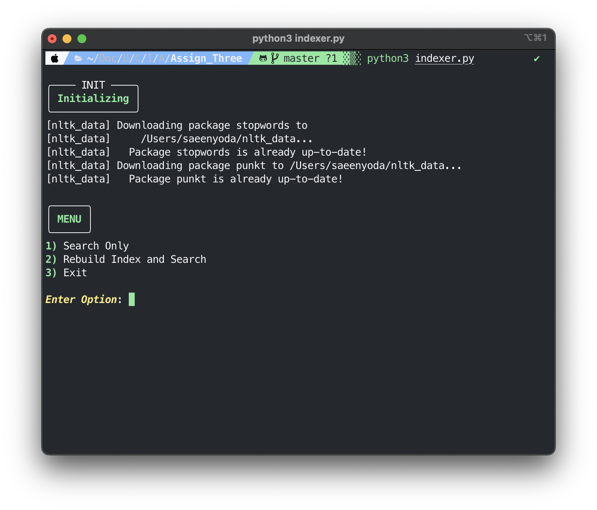
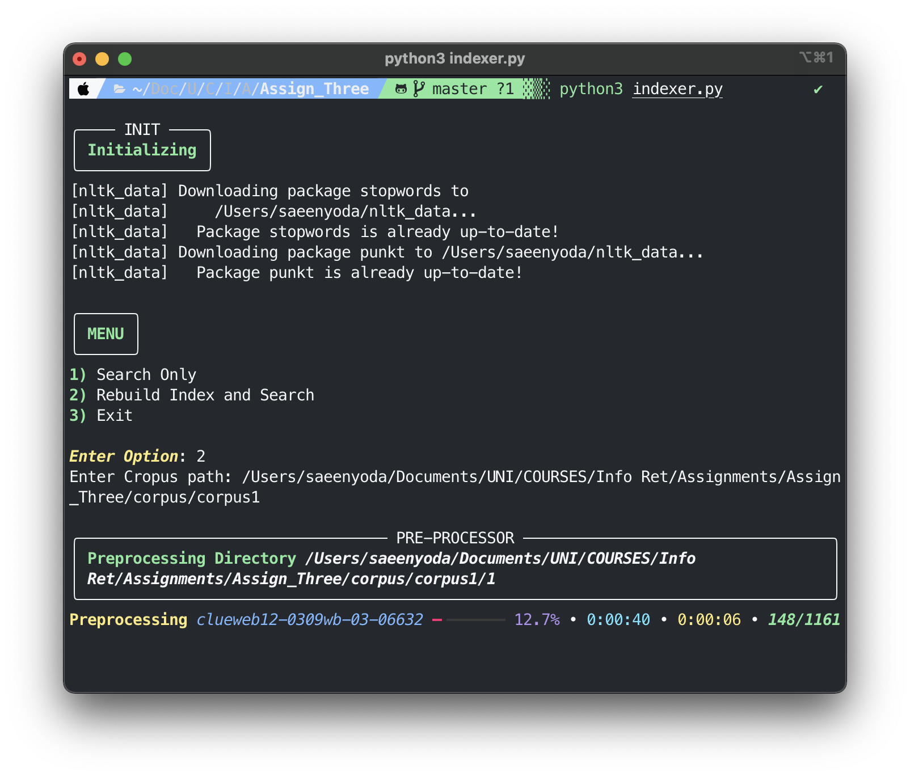
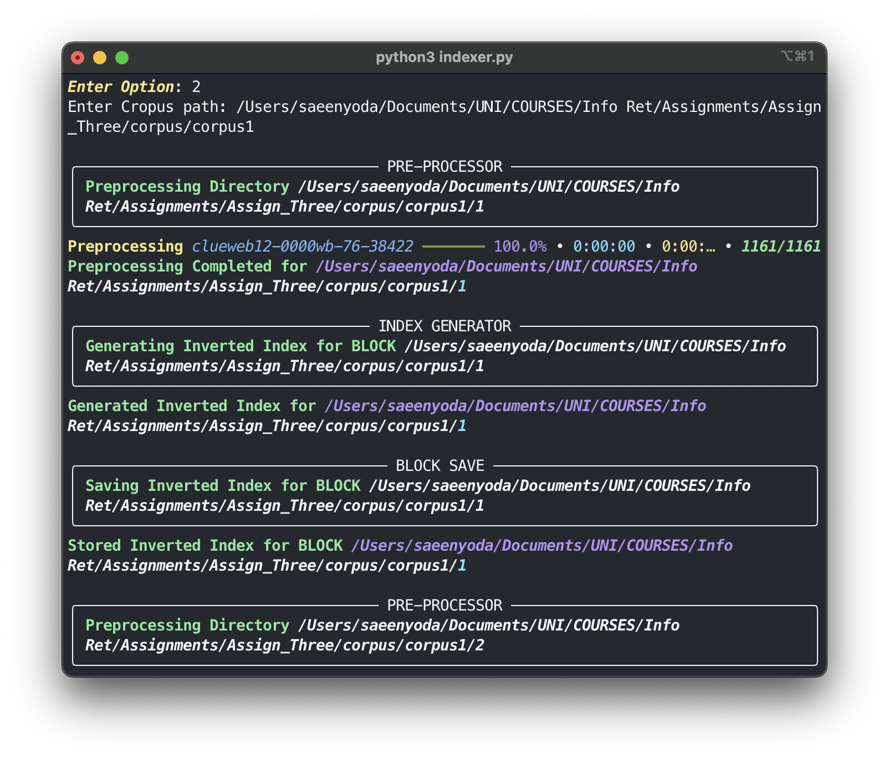
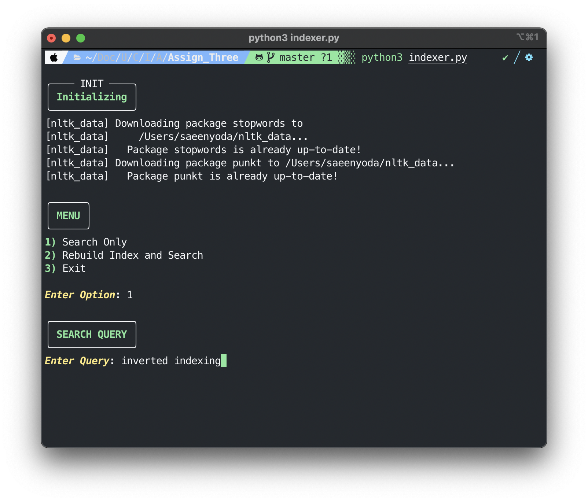
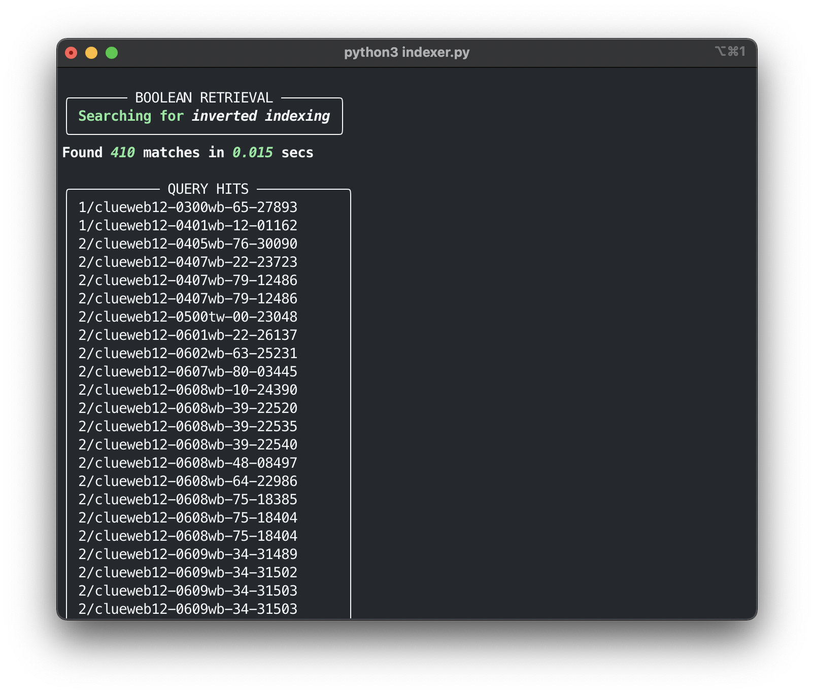

# Inverted Indexer

A word-level inverted index builder and search tool written in Python.

[](https://github.com/mosamaasif/Inverted_Indexer/blob/master/LICENSE)

## About

This is an [inverted index](https://en.wikipedia.org/wiki/Inverted_index) implementation I wrote for an Information Retrieval course. It builds a word-level index from a corpus of HTML or text documents, enabling fast full-text search. The pipeline includes HTML parsing with BeautifulSoup, tokenization and stopword removal with NLTK, and stemming with Snowball. A sample corpus is included in the `corpus/` directory.

## Features

- Builds a word-level inverted index from a directory of documents
- Parses HTML documents using BeautifulSoup
- Tokenization, stopword removal, and Snowball stemming via NLTK
- Ranked retrieval using TF-IDF weighting
- Interactive menu: search an existing index, rebuild from a corpus, or exit
- Supports nested corpus directories (subdirectories are merged during preprocessing)
- Rich terminal UI with progress bars and formatted output

## Built With

- [Python 3](https://www.python.org/)
- [NLTK](http://www.nltk.org) — tokenization, stemming, stopwords
- [Beautiful Soup](https://www.crummy.com/software/BeautifulSoup/) — HTML parsing
- [Rich](https://github.com/Textualize/rich) — terminal formatting and progress bars

## Getting Started

### Prerequisites

- [Python 3](https://www.python.org/downloads/)

### Installation & Running

```sh
git clone https://github.com/mosamaasif/Inverted_Indexer.git
cd Inverted_Indexer
pip3 install nltk rich beautifulsoup4
python3 indexer.py
```

On first run, you may need to download the NLTK data:
```python
import nltk
nltk.download('punkt')
nltk.download('stopwords')
```

### Usage

The program presents a menu with three options:

1. **Search Only** — search an existing index (must have been built previously)
2. **Rebuild Index and Search** — point it to a corpus directory (e.g., `corpus/`), rebuild the index, then search
3. **Exit**

> **Note:** The corpus can have subdirectories. Provide the path to the root directory and each subdirectory will be processed and merged automatically.

## Screenshots











## License

Distributed under the MIT License. See [LICENSE](LICENSE) for details.
